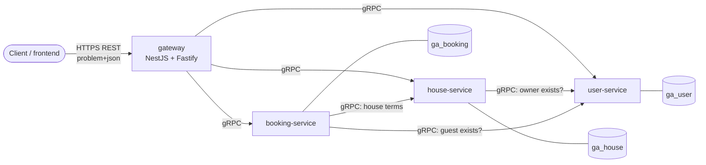
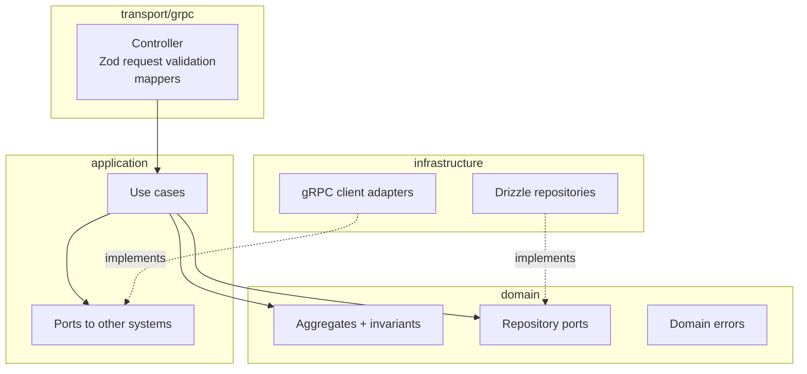

# Architecture overview

## Goals

1. Hundreds of services that all look the same inside, so any engineer (or AI agent)
   can work on any of them.
2. Correctness by construction: invariants in the database, typed contracts, one error
   model, no silent fallbacks.
3. A shared chassis instead of copy-paste, with a template that is continuously verified.
4. Fast local feedback: the whole system runs on a laptop without containers.

## Containers

- **Gateway**: the only public entrypoint; owns the REST contract, validation, OpenAPI,
  error presentation, rate limits and security headers. No business logic, no database.
- **Domain services**: own one capability and one database each; expose gRPC only;
  health via `grpc.health.v1`; server reflection on.
- **Dependencies form a DAG** (booking -> house -> user). Back-references will be events.

## Inside a service

The composition root (`app.module.ts`) binds ports to adapters. Biome blocks framework
and persistence packages and relative imports of the wrong layers in `src/domain` and
`src/application`; review covers what lint cannot see.

## Request lifecycle (create a booking)

1. Gateway (Fastify, HTTP/2 + TLS) assigns or accepts `x-request-id`, rate-limits,
   validates the body with Zod, calls `BookingService.CreateBooking` with a 5 s deadline.
2. booking-service validates the request (Zod), the use case validates the stay locally,
   then asks user-service and house-service in parallel (2 s deadlines, request id
   propagated, retry only when a request never reached a handler).
3. The aggregate prices the stay; the repository inserts it. Postgres' exclusion
   constraint rejects an overlapping confirmed booking atomically.
4. A violation becomes `ConflictError(BOOKING_DATES_UNAVAILABLE)` -> gRPC
   `ALREADY_EXISTS` + `google.rpc.ErrorInfo` -> HTTP 409 problem+json with `code`.
5. Every hop logs one JSON line with the same `requestId`; with OTLP configured, one trace
   spans the gateway, the three services and their SQL.

## Cross-cutting conventions

| Concern    | Convention                                                                  | Where                                                                         |
| ---------- | --------------------------------------------------------------------------- | ----------------------------------------------------------------------------- |
| Errors     | `DomainError` kinds -> gRPC status + ErrorInfo/BadRequest -> RFC 9457       | ADR-0003, `@ga/kernel`, kit `GrpcErrorFilter`, gateway `ProblemDetailsFilter` |
| Ids        | UUIDv7 from `IdGenerator`                                                   | `@ga/kernel`, kit                                                             |
| Pagination | keyset on id, opaque filter-bound tokens, max 100                           | `@ga/kernel`                                                                  |
| Money      | integer minor units + ISO currency                                          | `@ga/kernel` `Money`, `ga.common.v1.Money`                                    |
| Config     | Zod schema per process, fail fast at boot                                   | kit `parseConfig`                                                             |
| Logging    | pino JSON, one line per RPC/request, request id on every line               | kit, nestjs-pino                                                              |
| Tracing    | OpenTelemetry, enabled by `OTEL_EXPORTER_OTLP_ENDPOINT`                     | `@ga/service-kit/telemetry`                                                   |
| Health     | `grpc.health.v1` per service (DB-aware); gateway `/healthz`, `/readyz`      | kit `HealthStatus`                                                            |
| Shutdown   | NOT_SERVING -> optional drain delay -> graceful gRPC shutdown -> close pool | kit                                                                           |
| Contracts  | one buf module, STANDARD lint, FILE breaking check, committed codegen       | `packages/contracts`                                                          |

## Scaling to hundreds of services

- **Generation, not copying**: `pnpm new:service` keeps services identical;
  `pnpm template:verify` keeps the template green.
- **One chassis**: cross-cutting fixes land once in `@ga/service-kit`.
- **Catalog**: `services.json` is the registry of ports, databases and env names that local
  tooling consumes; at larger scale it becomes the service catalog (owners, tiers, SLOs).
- **Contract governance**: every proto change is linted and checked for breaking changes
  against `main`; versions are explicit (`v1`, `v2`).
- **Build cost**: Turborepo caches by content; only affected packages rebuild and retest.
- **Ownership**: add a `CODEOWNERS` entry per `apps/<service>` and per proto directory when
  teams form.
- **Skills as the spec**: the `ga-platform` plugin is the executable specification;
  update it in the same PR as the convention it documents.

## Decisions

- ADR-0001 Platform stack
- ADR-0002 Service boundaries and communication
- ADR-0003 API and error conventions
- ADR-0004 Identity and authorization (proposed)
- ADR-0005 Asynchronous events (proposed)
